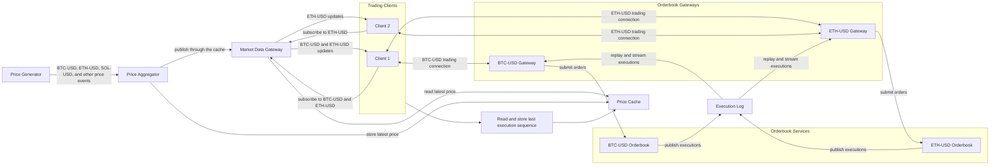

# System architecture

Each rectangle is an independently running service namely:

- 1 Price Generator (service)
- 1 Price Aggregator (service)
- 1 Price Cache (valkey)
- 1 Market Data Gateway (service)
- N number of clients (service)
- 5 Orderbook Gateways (service)
- 5 Orderbooks (service)
- 1 Execution Log (redpanda)

> TODO: rewrite into headings and mention the purpose of each component

The `Price Generator` semi-randomly creates a price for each instrument at some interval. The price is dependent on the previous price with a slight delta and there are upper and lower bounds for each instrument.

Every price update is sent to the `Price Aggregator` through `gRPC`.

The aggregator stores the latest price for each instrument in the price cache. Clients are started with a random inventory that they track in-memory and subscribe to price updates from the `Market Data Gateway` for their selected instruments. The connection between the gateway and client is a single `websocket`. The gateway reads the stored price and forwards it to clients subscribed to that instrument.

When a client receives a price update it makes a decision if it should perform an action on an orderbook for that instrument.

Each orderbook handles 1 instrument and there is 1 `Orderbook Gateway` for each orderbook. Each client has a single `websocket` connection to that instrument's `Orderbook Gateway`. The gateway accepts requests after the client has completed a login sequence and forwards `place` and `cancel` requests to the orderbook through `gRPC`.

The orderbook publishes every trade, acceptance, rejection, and cancellation to the execution log. The record is keyed by client ID and carries that client's next execution sequence. The gateway reads the log from the start, skips sequences the client has already applied, and keeps forwarding new records on the same websocket. The client stores its latest sequence in the price cache under a separate key prefix.

There is no appropriate sequence replay mechanism therefore if a client receives sequence 5 before sequence 4 then once sequence 4 arrives it will be dropped, leading to a desync of the client and incorrect trading actions for future messages. However, sequences are written and sent in order so that should not occur in this sandbox.

The following diagram is slightly simplified but generally correct.

