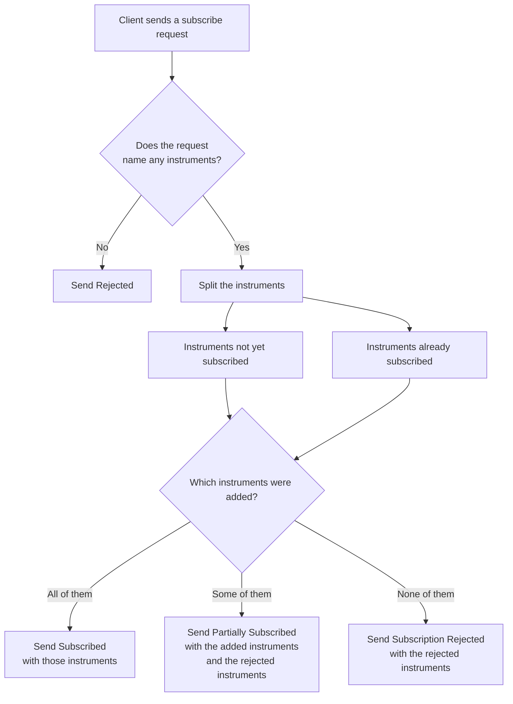
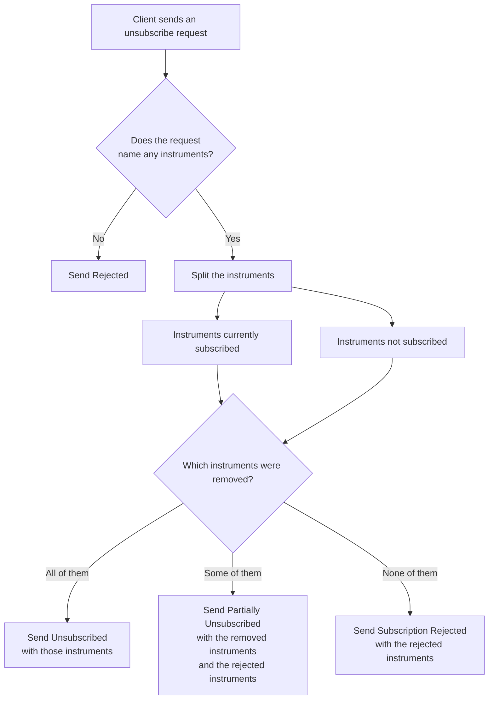
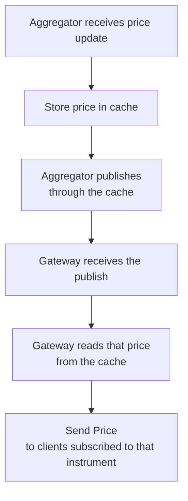

# Subscriptions

## Market data provider gateway

One WebSocket carries subscription changes and price updates.

### Subscribe

The client sends the instruments it wants prices for. An instrument already in that client's subscription is rejected and every other instrument is added. The client is informed about the result of all instruments.

### Unsubscribe

The client sends the instruments it no longer wants. An instrument that is not in that client's subscription is rejected and every other instrument is removed. The client is informed about the result of all instruments.

### Price update

When the price generator sends an update for an instrument the aggregator stores the latest price in the cache and publishes a message. The gateway receives the message, reads that price and sends it to clients subscribed to that instrument.

